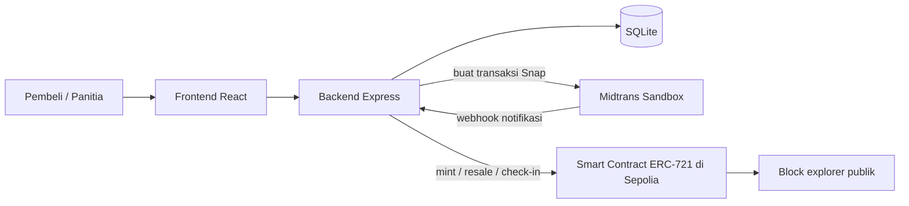
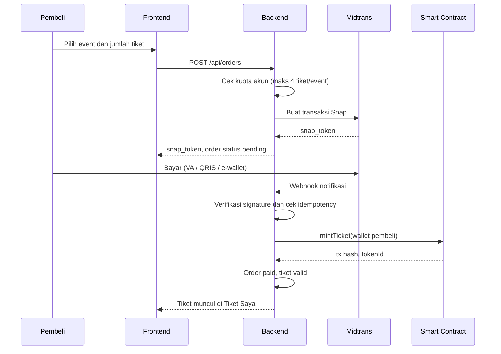

# Arsitektur Sistem TiketAman

## 1. Komponen
| Komponen | Teknologi | Peran |
|---|---|---|
| Frontend | React + Vite | Katalog event, checkout, tiket saya, resale, halaman scanner |
| Backend | Node.js + Express | Auth, order, webhook Midtrans, memanggil smart contract |
| Database | SQLite | Data user, event, order, tiket, resale, log webhook |
| Payment gateway | Midtrans Sandbox (Snap) | VA, QRIS, e-wallet (simulasi) |
| Blockchain | Solidity ERC-721, Hardhat, Sepolia | Tiket sebagai token, aturan anti-calo |
| RPC | Alchemy/Infura (gratis) | Penghubung backend ke Sepolia |

## 2. Diagram komponen

## 3. Alur utama: beli tiket

## 4. Alur resale
1. Pemilik membuat listing. Backend dan kontrak menolak harga di atas `faceValue x maxResaleBps / 10000`.
2. Pembeli baru membayar lewat Midtrans (alur sama seperti beli tiket).
3. Webhook sukses memicu `executeResale` di kontrak, kepemilikan token berpindah, event `ResaleExecuted` tercatat publik.

## 5. Alur check-in
1. Aplikasi pemilik menampilkan QR yang berganti tiap 60 detik (token bertanda tangan + timestamp).
2. Scanner mengirim QR ke backend. Backend memeriksa tanda tangan, usia QR, dan pemilik.
3. Backend memanggil `markUsed(tokenId)`. Pemakaian kedua ditolak oleh kontrak dan oleh constraint UNIQUE di tabel `checkins`.

## 6. Pembagian tanggung jawab on-chain vs off-chain
| On-chain (kontrak) | Off-chain (backend/DB) |
|---|---|
| Kepemilikan token, riwayat transfer | Akun, password, NIM ter-hash |
| Batas harga resale (dikunci saat `createEvent`) | Pembayaran rupiah dan status order |
| Status `used`, batas per alamat | Rekonsiliasi dan laporan |
| Event `ResaleExecuted` (audit publik) | Tampilan, QR berputar, notifikasi |

## 7. Alasan blockchain dipakai (untuk presentasi)
Basis data biasa bisa membatasi harga, tetapi pemilik sistem dapat mengubahnya diam-diam. Di kontrak, batas harga dikunci saat event dibuat dan tidak ada fungsi untuk mengubahnya, riwayat token dapat diperiksa siapa pun lewat block explorer. Keterbatasannya: blockchain tidak menghentikan akun ganda (ditangani verifikasi email kampus + hash NIM) dan ada biaya komputasi (ditekan dengan jaringan L2 pada produksi, prototipe memakai Sepolia).

## 8. Keamanan (standar teknis tugas)
- Signature webhook Midtrans diverifikasi (SHA512 dari order_id + status_code + gross_amount + server key).
- API key dan private key hanya di `.env`, tidak pernah di kode atau Git.
- Idempotency: UNIQUE (midtrans_order_id, transaction_status) di `payment_notifications`.
- Private key wallet custodial dienkripsi (AES-256-GCM) sebelum disimpan.
- Uji skenario sukses, gagal, dan kedaluwarsa.

## 9. Keputusan desain
| Keputusan | Alasan |
|---|---|
| SQLite | Tanpa instalasi server DB, cukup untuk prototipe |
| Wallet custodial | Pembeli tidak perlu paham kripto |
| Backend yang membayar gas | Pengalaman pembeli tetap rupiah saja |
| Sepolia testnet | Syarat tugas, tidak ada nilai uang nyata |
| `transferFrom` dinonaktifkan | Mencegah jual diam-diam di luar platform |
